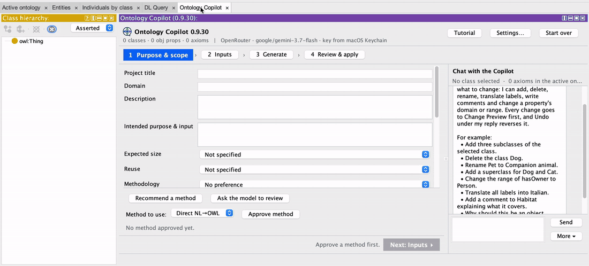

<div align="center">
  <picture>
    <source media="(prefers-color-scheme: dark)" srcset="images/logo-dark.png">
    
  </picture>
</div>

# Ontology Copilot 

A plugin for [Protégé](https://protege.stanford.edu) that helps you draft and edit ontologies with an LLM assistant,
using methods from peer-reviewed research (NeOn-GPT, Ontogenia, RIGOR-Lite, and a direct draft). Every change is shown
in Change Preview first; nothing changes in your ontology until you press Apply.

<p align="center">
  
</p>

**New in 0.9.34:** Purpose & scope asks **what you already have** (competency questions, user stories, documents, ontologies to reuse, design patterns or a database schema), and the recommended method follows from it: a database schema leads to **RIGOR-Lite**, design patterns to **Ontogenia**, ontologies to reuse to **NeOn-GPT**. The recommendation updates as you fill in the page and says when your methodology choice is not followed. Choose a **Label language** and every method writes its labels and comments in it. **Next** shows in red what is still missing, every optional field says "(optional)", and info windows open big enough for their text.

Already installed it with Option 1? **File ▸ Check for plugins…** offers the update.

## Install

> **Tested with Protégé 5.6.7 on macOS only.** It may not work with other Protégé versions.

There are two ways. Option 1 needs no files or folders; if it doesn't work for you, use Option 2.

### Option 1: Protégé's plugin installer

1. In Protégé, open the preferences (macOS: **Protégé ▸ Settings…**; Windows / Linux: **File ▸ Preferences…**) and go
   to the **Plugins** tab. In **Plugin registry**, paste

   ```
   https://raw.githubusercontent.com/NadeenAhmad/protege-ontology-copilot/main/ontology-copilot.repository
   ```

   and click **OK**. Protégé's standard plugins stay in the list.

   

2. Choose **File ▸ Check for plugins…**. In the list, find **Ontology Copilot** and tick its box in the **Install**
   column (far left). Then click **Install**. Without the tick, nothing is installed.

   

3. Protégé says the plugin takes effect at the next start. Click **OK**, **quit Protégé and start it again**. Before
   the restart the plugin does not work yet: it may already be listed under Window ▸ Views, but clicking it does
   nothing.

   

After the restart, click the **Ontology Copilot** tab. If there is no such tab, choose **Window ▸ Tabs ▸ Ontology
Copilot**.

Protégé puts plugins installed this way in its own `plugins` folder, or, when it can't write there, in your user
folder (`~/.Protege/plugins`). On a Mac this happens when Protégé runs from the Downloads folder; moving Protégé to
Applications first avoids it, but both work. If you installed the plugin by hand before (Option 2), delete that copy
from Protégé's `plugins` folder first, so Protégé doesn't find two.

### Option 2: by hand

1. Download [`protege-ontology-copilot-0.9.34.jar`](protege-ontology-copilot-0.9.34.jar).
2. Quit Protégé and copy the file into Protégé's `plugins` folder:
   - macOS: right-click Protégé.app ▸ **Show Package Contents** ▸ `Contents` ▸ `plugins`;
   - Windows / Linux: the `plugins` folder inside the Protégé folder.

   Delete any older `protege-ontology-copilot-…jar` there.

   

3. Start Protégé.

## First start

1. Open or create an ontology and click the **Ontology Copilot** tab. If you don't see it (this can happen when you
   used Protégé before), choose **Window ▸ Tabs ▸ Ontology Copilot**.

   

2. A short guided tour starts the first time. Skip it, or click through its 15 steps (the last four are inside
   **Model & Settings**); the **Tutorial** button (top right) starts it again.

   

3. At every start, a bar at the top asks you to check your AI model; until a key is set up, it says **Set up your AI
   model first**. Click **Open Model & Settings** in that bar (or **Model & Settings**, top right). The plugin starts
   with **GPT-5.6 Luna** through **OpenRouter**: paste your OpenRouter API key under **API key**, right below the model,
   and click **Use for this session only** (or **Save to Keychain** on macOS), then **Test connection**. To use another model, choose a **Provider** (OpenRouter, OpenAI, Anthropic, Google Gemini or a
   local Ollama) and a **Model**; Ollama needs no key. The plugin remembers the provider and model for next time; the
   key only if you saved it to the Keychain.

   Further down, under **Ontology draft quality check**, click **Install RDFLib** if it says the file check isn't
   installed. RDFLib is a free Python library that reads each draft's file strictly: it catches small typing mistakes,
   such as a missing dot, that Protégé's own reader quietly accepts. Installing it takes about a minute, needs Python 3
   and internet, and installs only into the plugin's own folder (`~/.ontology-copilot/python`). Without it everything
   still works; the file check is skipped ("⚠ One check was skipped"), and the plugin says so wherever it matters. The
   same section has the **Modeling mistakes check (OOPS!)**; the plugin also asks about it when your first NeOn-GPT or
   Ontogenia draft arrives, and the Run NeOn-GPT window can turn it on or off.

   

4. Follow the steps at the top: **1 Purpose & scope › 2 Inputs › 3 Generate › 4 Review & apply**. **Next** and **Back** are at
   the bottom of each page; if something is still missing, Next shows it in red. Nothing changes in your ontology until
   you click **Apply** in step 4, and **Undo** there takes it out again.

   In **Purpose & scope**, fill in the domain and tick what you already have (competency questions, documents,
   ontologies to reuse, design patterns or a database schema); the recommended method follows from it: a database
   schema leads to **RIGOR-Lite**, design patterns to **Ontogenia**, ontologies to reuse to **NeOn-GPT**. Choose a
   **Label language** there to have the labels and comments written in it. Every field marked "(optional)" can stay
   empty.

5. The chat on the right works on any step. Press **Enter** to send (**Shift+Enter** for a new line). Not sure what to
   ask? Click one of its examples, or **What can I ask Ontology Copilot?** below the box. In a hurry, skip the steps and
   ask the chat for a first draft, for example *Draft a small ontology about bike sharing*; for a more thorough draft
   with quality checks, use the steps.

## Your data

- Your API key stays on your computer: in the macOS Keychain, or only for the current session.
- The plugin keeps a local activity log of what you do in it. It is never sent anywhere (see below).
- Modeling mistakes check (OOPS!): only if you agree (the plugin asks once; change it in Model & Settings ▸ Ontology draft
  quality check, or in the Run NeOn-GPT window), each NeOn-GPT and Ontogenia
  draft is sent with your ontology to the OOPS! service at oops.linkeddata.es (Universidad Politécnica de Madrid).
  Without a yes, nothing is sent there unless you click **Check now** for a single draft.

### Activity log

The activity log is **on by default**.

- **Switch it on or off:** click **Model & Settings** (top right of the plugin), and under **Privacy** tick or untick
  **"Keep a local activity log (for research you may share; nothing is sent)"**.
- **Find it:** in the same window, click **Open activity folder**. The folder is
  `~/Documents/OntologyCopilot/activity` on macOS and Linux, and `C:\Users\<name>\Documents\OntologyCopilot\activity`
  on Windows.
- **What's in it:** two files per session, named after the time it started: `…-events.jsonl` (what you did, one line
  per action) and `…-explanations.md` (the explanations the plugin gave). A session starts when the plugin's view opens
  and ends when the ontology is saved or the view closes. Your API key is never written to these files.

## In this repository

- `protege-ontology-copilot-0.9.34.jar`: the plugin.
- `update.properties`, `ontology-copilot.repository`, `readme.html`: what Protégé's plugin installer reads.
- `images/`: the logos, screenshots and the demo GIF used here.

## Licence

MIT, see [LICENSE](LICENSE).
