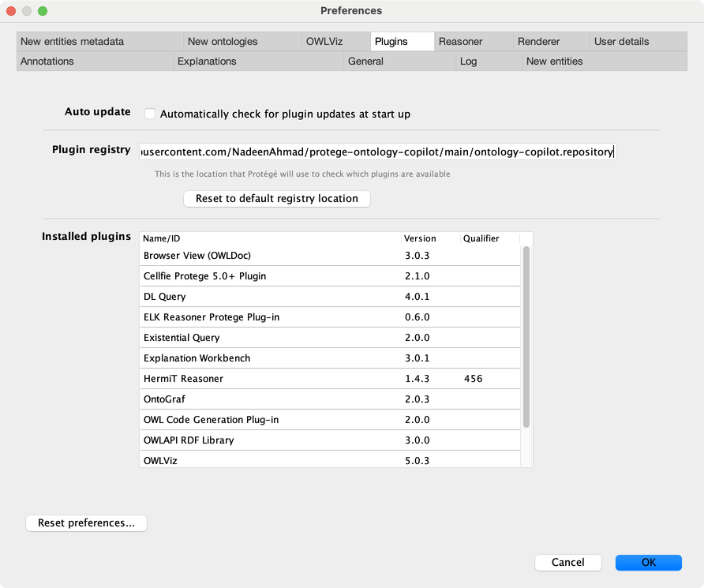
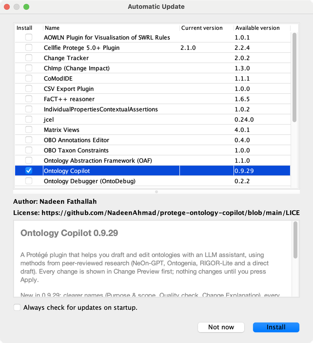
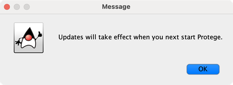
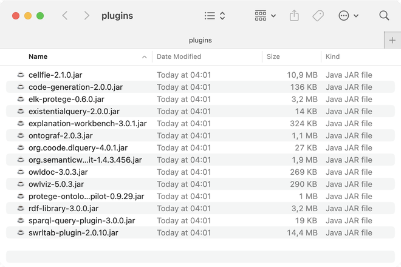
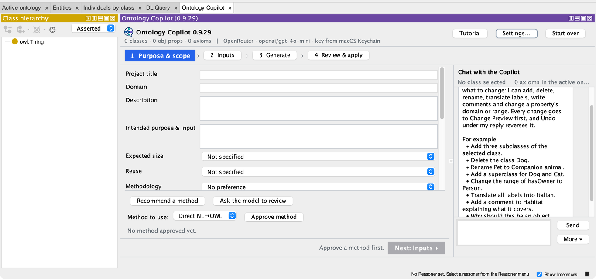
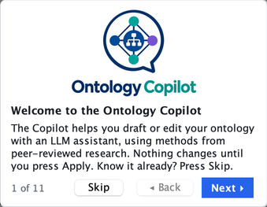
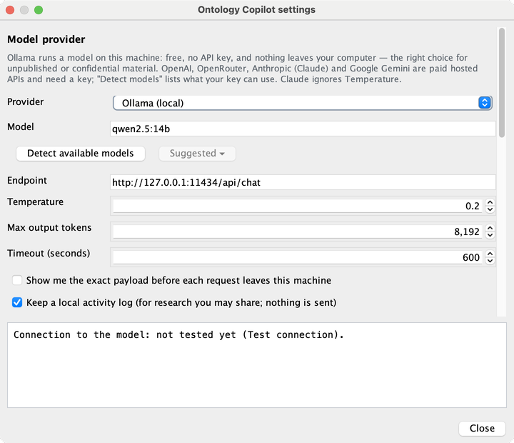

<div align="center">
  <picture>
    <source media="(prefers-color-scheme: dark)" srcset="images/logo-dark.png">
    
  </picture>
</div>

# Ontology Copilot 

A plugin for [Protégé](https://protege.stanford.edu) that helps you draft and edit ontologies with an LLM assistant,
using methods from peer-reviewed research (NeOn-GPT, Ontogenia, RIGOR-Lite, and a direct draft). Every change is shown
in Change Preview first; nothing changes in your ontology until you press Apply.

**New in 0.9.29:** clearer names: step 1 is now **Purpose & scope**, the checks tab is **Quality check**, and **Change Explanation** sits right next to Change Preview. Every slow action shows that it is working, with changing words and the seconds, and the Copilot mark appears in the chat and the top bar. NeOn-GPT now keeps its own fix when RDFLib isn't installed (before, it threw the fix away), the reasoner checks your ontology again after Apply, and a critical OOPS! mistake can still be fixed after Apply. New one-click **Declare them** for classes or properties that are used but never declared, a plain window before Apply, chat buttons that follow what you do in Change Preview, and a simpler step 3.

Already installed it with Option 1? **File ▸ Check for plugins…** offers the update.

## Install

> **Tested with Protégé 5.6.7 on macOS only.** It may not work with other Protégé versions.

There are two ways. Option 1 needs no files or folders; if it doesn't work for you, use Option 2.

### Option 1: Protégé's plugin installer

1. In Protégé, open the preferences (macOS: **Protégé ▸ Settings…**; Windows / Linux: **File ▸ Preferences…**) and go
   to the **Plugins** tab. In **Plugin registry**, paste

   ```
   https://raw.githubusercontent.com/NadeenAhmad/protege-ontology-copilot/main/ontology-copilot.repository
   ```

   and click **OK**. Protégé's standard plugins stay in the list.

   

2. Choose **File ▸ Check for plugins…**, tick **Ontology Copilot** and click **Install**.

   

3. Protégé says the plugin takes effect at the next start. Click **OK** and restart Protégé.

   

Protégé puts plugins installed this way in its own `plugins` folder or in your user folder (`~/.Protege/plugins`). If you
installed the plugin by hand before (Option 2), delete that copy from Protégé's `plugins` folder first, so Protégé
doesn't find two.

### Option 2: by hand

1. Download [`protege-ontology-copilot-0.9.29.jar`](protege-ontology-copilot-0.9.29.jar).
2. Quit Protégé and copy the file into Protégé's `plugins` folder:
   - macOS: right-click Protégé.app ▸ **Show Package Contents** ▸ `Contents` ▸ `plugins`;
   - Windows / Linux: the `plugins` folder inside the Protégé folder.

   Delete any older `protege-ontology-copilot-…jar` there.

   

3. Start Protégé.

## First start

1. Open or create an ontology and click the **Ontology Copilot** tab. If you don't see it (this can happen when you
   used Protégé before), choose **Window ▸ Tabs ▸ Ontology Copilot**.

   

2. A short guided tour starts the first time. Skip it, or click through its 11 steps; the **Tutorial** button (top
   right) starts it again.

   

3. Click **Settings…** (top right), choose a **Provider** (OpenRouter, OpenAI, Anthropic, Google Gemini or a local
   Ollama) and a **Model**, paste your API key further down and click **Use for this session only** (or **Save to
   Keychain** on macOS), then **Test connection**. Ollama needs no key. The plugin remembers the provider and model
   for next time; the key only if you saved it to the Keychain.

   Further down, under **Quality check**, click **Install RDFLib** if it says the file check isn't installed. It needs
   Python 3 and internet, and installs only into the plugin's own folder (`~/.ontology-copilot/python`). Without it
   everything still works; the file check is skipped, and the plugin says so wherever it matters. The same section has **Check drafts
   for common modelling mistakes (OOPS!)**; the plugin also asks about it when your first NeOn-GPT or Ontogenia draft
   arrives.

   

4. Follow the steps at the top: **1 Purpose & scope › 2 Inputs › 3 Generate › 4 Review & apply**. **Next** and **Back** are at
   the bottom of each page; when Next is grey, the reason is written beside it. Nothing changes in your ontology until
   you click **Apply** in step 4, and **Undo** there takes it out again.

## Your data

- Your API key stays on your computer: in the macOS Keychain, or only for the current session.
- The plugin keeps a local activity log of what you do in it. It is never sent anywhere (see below).
- OOPS! Check: only if you agree (the plugin asks once; change it in Settings ▸ Quality check), each NeOn-GPT and Ontogenia
  draft is sent with your ontology to the OOPS! service at oops.linkeddata.es (Universidad Politécnica de Madrid).
  Without a yes, nothing is sent there unless you click **Check now** for a single draft.

### Activity log

The activity log is **on by default**.

- **Switch it on or off:** click **Settings…** (top right of the plugin), and tick or untick
  **"Keep a local activity log (for research you may share; nothing is sent)"**.
- **Find it:** in the same Settings window, click **Open activity folder**. The folder is
  `~/Documents/OntologyCopilot/activity` on macOS and Linux, and `C:\Users\<name>\Documents\OntologyCopilot\activity`
  on Windows.
- **What's in it:** two files per session, named after the time it started: `…-events.jsonl` (what you did, one line
  per action) and `…-explanations.md` (the explanations the plugin gave). A session starts when the plugin's view opens
  and ends when the ontology is saved or the view closes. Your API key is never written to these files.

## In this repository

- `protege-ontology-copilot-0.9.29.jar`: the plugin.
- `update.properties`, `ontology-copilot.repository`, `readme.html`: what Protégé's plugin installer reads.
- `images/`: the logos and screenshots used here.

## Licence

MIT, see [LICENSE](LICENSE).
